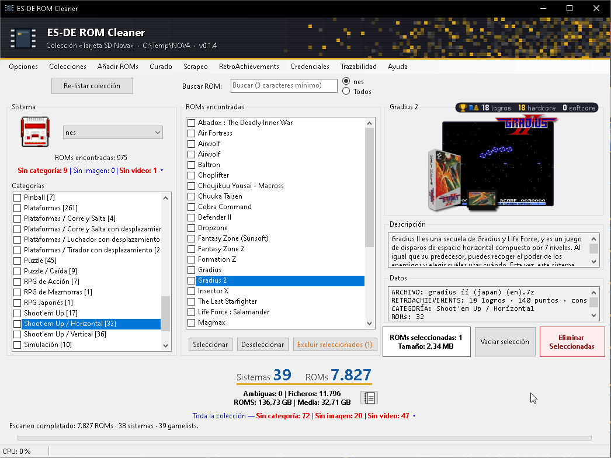
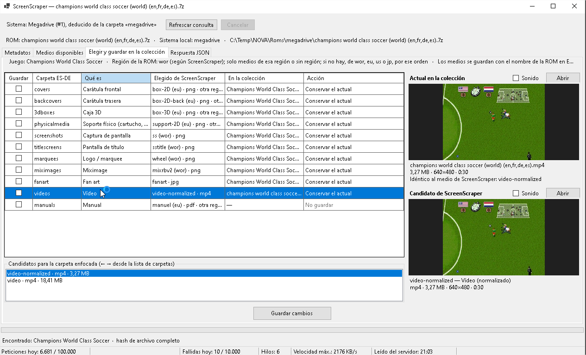
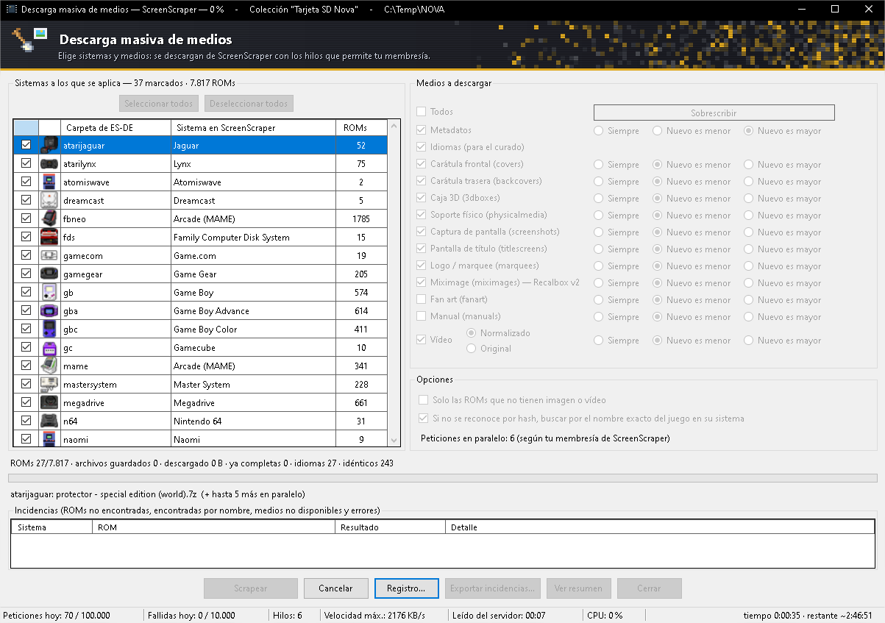
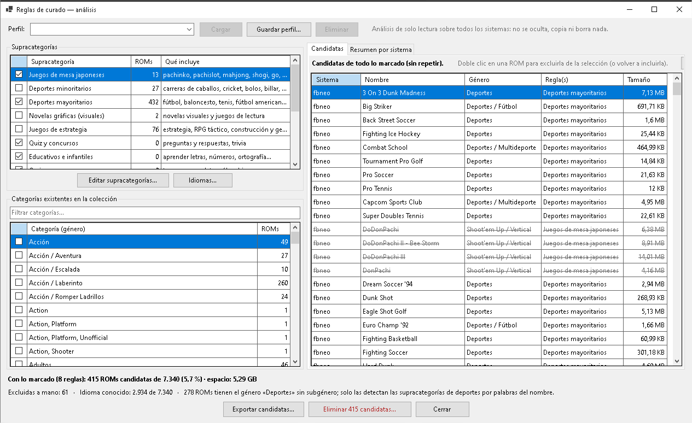
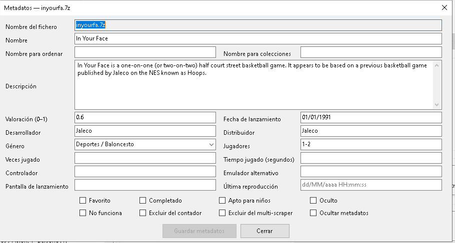

# ES-DE ROM Cleaner

Herramienta de escritorio para Windows que ayuda a **mantener y "curar" una colección de [ES-DE](https://es-de.org/)** (EmulationStation Desktop Edition): explorar tus ROMs por género, ver sus imágenes y vídeos, completar su información con [ScreenScraper](https://www.screenscraper.fr/), quitar de la colección lo que no te interesa y clonar el resultado a otra carpeta o dispositivo.

> **Aviso:** el borrado de ROMs y de sus archivos asociados es **permanente** (no pasa por la Papelera). Antes de usarlo en serio, prueba con una copia de tu colección.

La interfaz, los mensajes y los comentarios del código están en **español**.

## Qué puedes hacer

- **Explorar** la colección por sistema y género, con búsqueda (también por expresión regular), vista previa de la *miximage* y reproducción del vídeo de la ROM enfocada.
- **Editar metadatos** de un juego (`gamelist.xml`): nombre, descripción, valoración, fecha, desarrollador, género, favoritos, etc.
- **Scrapear con ScreenScraper**:
  - Consulta de una ROM por hash (o por nombre), con todos sus metadatos y medios disponibles.
  - Descarga de los medios para **compararlos** (imágenes, vídeos con sonido opcional) y elección de cuáles guardar en las carpetas de `downloaded_media` de ES-DE.
  - **Descarga masiva** para uno o varios sistemas: carpetas de medios a elegir, vídeo normalizado u original, qué hacer si ya existe el archivo, metadatos y idiomas, varias peticiones en paralelo según tu membresía, reanudable, con porcentaje total y tiempo restante, y resumen final del espacio ahorrado o añadido.
- **Curado del romset** (menú *Curado*): marca géneros y *supracategorías* editables (juegos de mesa japoneses, deportes minoritarios o mayoritarios, novelas visuales, estrategia, quiz, educativos…) y la herramienta te muestra qué ROMs saldrían como candidatas a descartar, con el motivo, el espacio que liberarías y el desglose por sistema. Puedes excluir ROMs a mano, guardar tus selecciones como **perfiles**, filtrar por **idioma** (los idiomas de cada ROM se traen de ScreenScraper) y, si te convence, eliminar las candidatas.
- **Borrado seguro**: plan previo con todo lo que se va a tocar (ROMs, archivos accesorios, media, gamelists), comprobación de que nada ha cambiado antes de ejecutar, copia de seguridad opcional de los gamelists y actualización solo de los sistemas afectados.
- **Clonar** la colección a otra carpeta con `robocopy /MIR`, validando que origen y destino no se solapan.
- **Trazabilidad**: cada acción relevante queda anotada en un registro que se puede consultar desde la propia aplicación.

## Capturas

**Ventana principal.** Sistemas, géneros, ROMs de cada género, miximage y descripción de la ROM enfocada.



**Scrapeo de una ROM.** Compara el medio que ya tienes con el que ofrece ScreenScraper (imagen o vídeo, con sonido opcional) y elige qué guardar en cada carpeta de ES-DE.



**Descarga masiva.** Varios sistemas a la vez, con el porcentaje total en el título, el tiempo restante estimado y la lista de incidencias.



**Curado del romset.** Marca géneros y supracategorías para ver qué ROMs saldrían como candidatas a descartar, con el espacio que liberarías; las excluidas a mano aparecen tachadas.



**Editor de metadatos.** Compacto, con el género en un desplegable y el botón de guardar activo solo si hay cambios.



## Descargar

En la sección [**Releases**](../../releases) tienes `ESDERomCleaner-<versión>-win-x64.exe`: un único ejecutable que **no necesita instalar .NET** (lleva el motor de vídeo incluido). Descárgalo y ábrelo; la primera vez tarda unos segundos más porque se extrae a una carpeta temporal.

Como el ejecutable no está firmado, Windows SmartScreen puede avisar la primera vez: pulsa *Más información › Ejecutar de todos modos*.

## Requisitos para compilar

- Windows 10/11 de 64 bits.
- [.NET 10 SDK](https://dotnet.microsoft.com/download) para compilar.
- Una colección con la estructura de ES-DE (ver abajo).
- Para scrapear: una cuenta de [ScreenScraper](https://www.screenscraper.fr/) y las **credenciales de desarrollador** (ID y contraseña) que la API exige. Las credenciales se piden desde la propia aplicación, no se incluyen en el repositorio.

## Compilar y ejecutar

```bash
dotnet build          # genera bin/Debug/net10.0-windows/ESDERomCleaner.exe
dotnet run            # abre la aplicación
```

Todo el código está en un único proyecto (`ESDERomCleaner.csproj`). No hay proyecto de pruebas. El motor de vídeo (LibVLC) se incorpora mediante paquetes NuGet.

## Estructura de colección esperada

Se trabaja sobre una carpeta raíz que contiene:

```text
Roms/<sistema>/...                              ROMs (archivos o carpetas)
ES-DE/gamelists/<sistema>/gamelist.xml          listas de juegos
ES-DE/downloaded_media/<sistema>/<tipo>/...     imágenes, vídeos, manuales…
```

La aplicación recuerda la última carpeta raíz que analizó con éxito y comprueba que sea válida antes de empezar.

## Cómo se usa

1. Indica la carpeta raíz y pulsa **Analizar colección**.
2. **Scrapeo › Credenciales de ScreenScraper…** (o **Alta en ScreenScraper…** si todavía no tienes cuenta).
3. Para una ROM concreta: clic derecho › *Scrapear con ScreenScraper…*. Para sistemas enteros: **Scrapeo › Descarga masiva de medios…**
4. Para depurar la colección: **Curado › Reglas de curado (análisis)…**, marca lo que quieras descartar y revisa las candidatas antes de eliminar nada.

## Datos que guarda la aplicación

Todo vive en `%LOCALAPPDATA%\ESDERomCleaner`: opciones, caché del análisis, registro de trazas, caché y copias de seguridad de medios, índice de idiomas, perfiles y reglas del curado.

- Las **credenciales de ScreenScraper** se guardan cifradas con DPAPI (solo las puede leer tu usuario de Windows en ese equipo) y nunca se escriben en trazas ni en pantalla.
- La aplicación **no modifica** tus gamelists salvo cuando editas metadatos, descargas metadatos o eliminas ROMs, y siempre de forma atómica y conservando el resto del archivo tal cual.

## Seguridad del borrado y de las escrituras

- Todas las rutas se validan para que queden dentro de la carpeta de su sistema, y se rechazan enlaces simbólicos y uniones.
- Las escrituras se hacen en un archivo temporal que se valida antes de sustituir al original.
- Las copias de seguridad de los gamelists y de los medios sustituidos son opcionales.

## Estado del proyecto

Proyecto personal en desarrollo. Algunas partes del acceso a la API de ScreenScraper (búsqueda por nombre, lectura de la cuenta e idiomas de las ROMs) están escritas pero pendientes de verificar con respuestas reales. Pendiente a medio plazo: un visor de medios a pantalla completa y más opciones de qué hacer con las ROMs candidatas del curado (ocultarlas en ES-DE o generar una copia depurada).

Puedes ver más detalle técnico en [`CLAUDE.md`](CLAUDE.md).

## Créditos

- [ES-DE](https://es-de.org/) por el frontend cuya estructura se respeta.
- [ScreenScraper](https://www.screenscraper.fr/) por su base de datos y su API.
- [LibVLCSharp](https://github.com/videolan/libvlcsharp) y [VLC](https://www.videolan.org/) para la reproducción de vídeo.

## Licencia

Este proyecto se distribuye bajo la licencia [GNU GPL v3.0](LICENSE): puedes usarlo, estudiarlo y modificarlo, y si redistribuyes versiones modificadas debes publicarlas también bajo la misma licencia.
