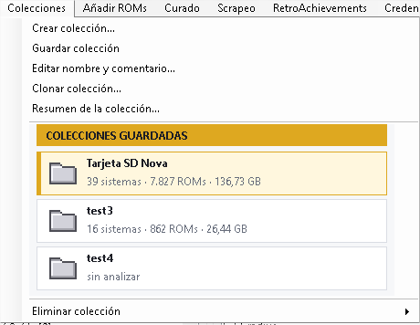
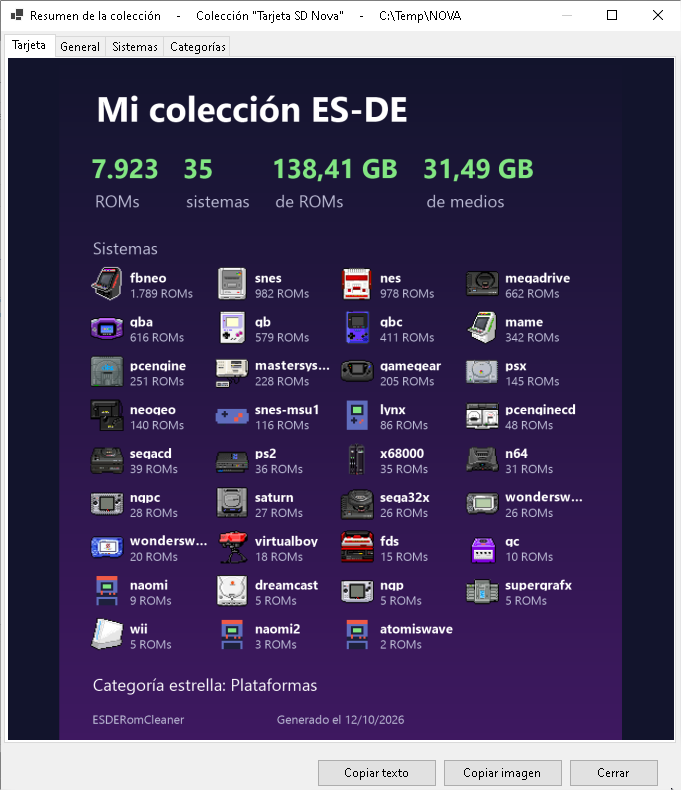
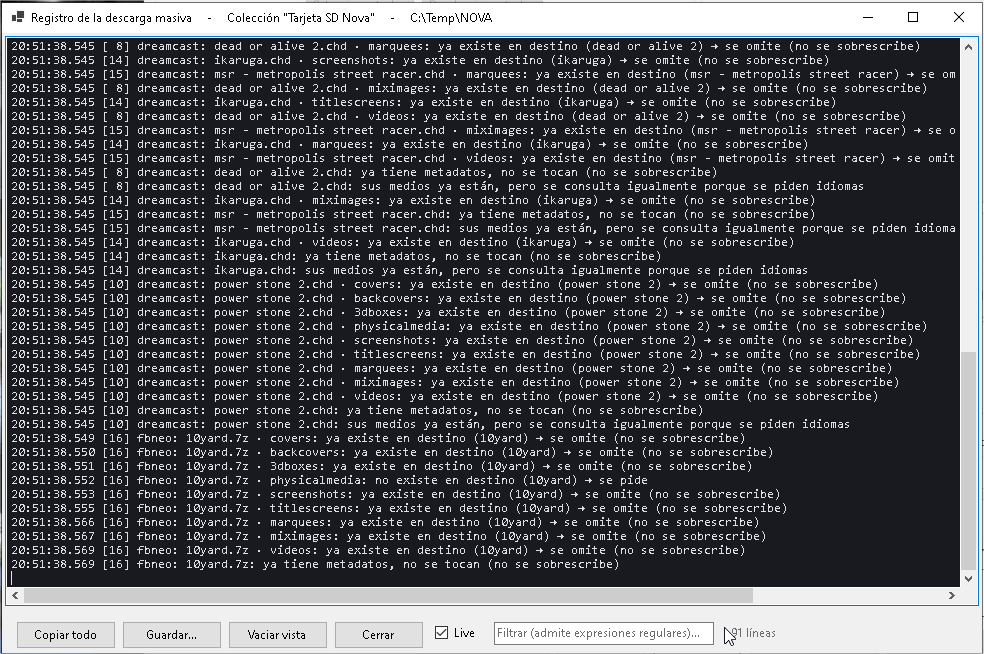
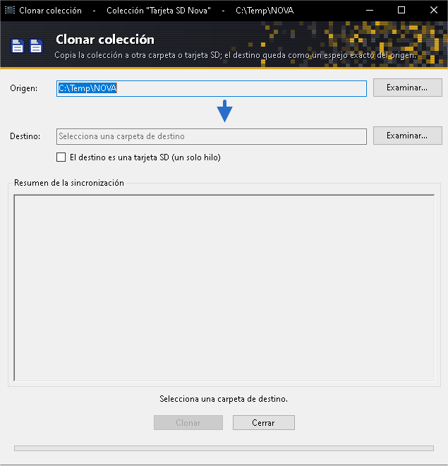

# ES-DE ROM Cleaner

Herramienta de escritorio para Windows que ayuda a **mantener y "curar" una colección de [ES-DE](https://es-de.org/)** (EmulationStation Desktop Edition): explorar tus ROMs por género, ver sus imágenes y vídeos, completar su información con [ScreenScraper](https://www.screenscraper.fr/), quitar de la colección lo que no te interesa y clonar el resultado a otra carpeta o dispositivo.

> **VERSIÓN ALPHA.** Este programa está en desarrollo activo y **pueden fallar muchas cosas**: errores, funciones a medio terminar, textos sin pulir y comportamientos sin probar con colecciones reales. Úsalo **siempre sobre una copia** de tu colección y avisa de lo que falle abriendo una [incidencia](../../issues).

> **Aviso:** el borrado de ROMs y de sus archivos asociados es **permanente** (no pasa por la Papelera). Antes de usarlo en serio, prueba con una copia de tu colección.

La herramienta trabaja sobre una colección con la **estructura de carpetas de ES-DE** (`Roms`, `ES-DE\gamelists`, `ES-DE\downloaded_media`). Si no la tienes, la propia aplicación puede **crearla completa** y **generar los `gamelist.xml`** a partir de tus ROMs (ver [Estructura de colección](#estructura-de-colección)). Hay más documentación en la [wiki](../../wiki).

La interfaz está en **español e inglés** (*Opciones › Idioma*; por defecto, el idioma de Windows). Los comentarios del código están en español.

## Qué puedes hacer

- **Crear la estructura de ES-DE** (carpetas de todos los sistemas oficiales, de medios y de datos, con su `systeminfo.txt`) si la ruta elegida no la tiene, y **generar los `gamelist.xml`** desde las ROMs que haya en cada carpeta. Si copias ROMs nuevas, al analizar te ofrece añadirlas al gamelist (y, si quieres, categorizarlas y descargar sus medios).
- **Añadir ROMs** (menú *Añadir ROMs*): arrastra archivos o carpetas (hasta 2 niveles de subcarpetas) y la aplicación las **identifica por hash** con los DAT de **No-Intro, Redump, TOSEC, MAME y FBNeo** (descargables desde la propia aplicación) o con los DAT que importes (GoodTools, clrmamepro, emuladores…), las coloca en la carpeta de su sistema y solo pregunta cuando hay dudas. Entiende **packs** (comprimidos con otros comprimidos dentro, recursivamente), prueba el hash sin cabecera (NES, FDS, Lynx, SNES…) y descarta lo que no son ROMs. Puedes elegir **cómo se guardan**: como llegan, sin comprimir, ZIP o 7z (con nivel de compresión; 7-Zip va incluido en la aplicación), respetando las extensiones que admite cada sistema. Identificar, copiar y comprimir se hace **en paralelo**. Las ROMs que ya existen en la colección se apartan en una lista de **duplicadas** (botón ⛔) y, al terminar de añadir, se ofrece **scrapear justo las añadidas**.
- **Explorar** la colección por sistema y categoría (género), con búsqueda (también por expresión regular), vista previa de la *miximage* y reproducción del vídeo de la ROM enfocada.
- **Editar metadatos** de un juego (`gamelist.xml`): nombre, descripción, valoración, fecha, desarrollador, género, favoritos, etc.
- **Scrapear con ScreenScraper**:
  - Consulta de una ROM por hash (también dentro de `.zip`, `.7z` y `.rar`) o por nombre, con todos sus metadatos y medios disponibles.
  - **Aproximaciones por nombre**: si ScreenScraper no reconoce la ROM, se muestran juegos parecidos con su miximage, nombre y descripción; al elegir uno puedes **descargar todo** (imágenes, vídeo y metadatos) o **elegir qué**.
  - Descarga de los medios para **compararlos** (imágenes, vídeos con sonido opcional) y elección de cuáles guardar en las carpetas de `downloaded_media` de ES-DE.
  - **Descarga masiva** para uno o varios sistemas: carpetas de medios a elegir, vídeo normalizado u original, qué hacer si ya existe el archivo, metadatos y idiomas, varias peticiones en paralelo según tu membresía, reanudable, con porcentaje total y tiempo restante, y resumen final del espacio ahorrado o añadido.
- **RetroAchievements** (menú *Scrapeo*): coteja tus ROMs con [RetroAchievements](https://retroachievements.org/) (por hash o por nombre, incluidos discos CHD de PSX, PS2, Sega CD y Saturn con lector propio) para saber **cuáles tienen logros**. Ves los logros de cada ROM (con tu progreso, **hardcore o softcore**, fecha, rareza y detalle), tu avatar, puesto y puntos, puedes **filtrar las ROMs con logros** y usarlo en el curado (regla *Sin logros*). Hace falta tu usuario y la **clave de la Web API**; no se escribe nada en los gamelists.
- **Curado del romset** (menú *Curado*): marca géneros y *supracategorías* editables (juegos de mesa japoneses, deportes minoritarios o mayoritarios, novelas visuales, estrategia, quiz, educativos…) y la herramienta te muestra qué ROMs saldrían como candidatas a descartar, con el motivo, el espacio que liberarías y el desglose por sistema. Puedes excluir ROMs a mano, guardar tus selecciones como **perfiles**, filtrar por **idioma** (los idiomas de cada ROM se traen de ScreenScraper) y, si te convence, eliminar las candidatas.
- **Borrado seguro**: plan previo con todo lo que se va a tocar (ROMs, archivos accesorios, media, gamelists), comprobación de que nada ha cambiado antes de ejecutar, copia de seguridad opcional de los gamelists y actualización solo de los sistemas afectados.
- **Clonar la estructura de ES-DE a otra carpeta o a una tarjeta SD** (botón *Clonar*): pensado para llevar la colección ya depurada a Android, donde ES-DE suele usarse con tarjeta SD. Ver [Clonar a otra carpeta o a una tarjeta SD](#clonar-a-otra-carpeta-o-a-una-tarjeta-sd).
- **Trazabilidad**: cada acción relevante queda anotada en un registro que se puede consultar desde la propia aplicación.
- **Interfaz en español e inglés** (*Opciones › Idioma*): «Predeterminado del sistema» (por defecto: el idioma de Windows si es español y, si no, inglés), Español o English, con cambio inmediato. En inglés, los metadatos que se descarguen a partir de ese momento (descripción y categoría) llegan en inglés; los gamelists que ya tienes no se tocan.
- **Colecciones** (menú *Colecciones*): crea una colección con un nombre, su carpeta y un comentario; cárgala cuando quieras desde el menú, que muestra los sistemas, ROMs y tamaño de cada una. Cada colección guarda su propio análisis, así que al volver a ella se ve al instante (con *Re-analizar colección* lo actualizas). Desde el mismo menú: **clonar**, **editar** y **eliminar** colecciones (eliminar solo la quita de la lista) y ver su **resumen**, con una tarjeta que puedes copiar al portapapeles para compartir.
- **Búsqueda** de ROMs en el sistema seleccionado o en todos (admite expresiones regulares); si el texto solo está en el nombre del archivo, este se muestra entre paréntesis.
- **Huecos de la colección**: por sistema y en total, cuántos juegos no tienen categoría, imagen o vídeo (la *imagen por defecto* se elige en *Opciones*), con acceso directo a scrapear justo los que faltan.
- **Excluir seleccionados**: marca ROMs como excluidas del contador y del multiscrapeo de ES-DE (`nogamecount` y `nomultiscrape`), desde la ventana principal o desde el curado, donde además se puede eliminar a partir del menú contextual.
- **Visor de medios**: un clic sobre la imagen o el vídeo pasa al siguiente medio de la ROM y un doble clic lo abre en una ventana grande.
- **Registro de la descarga masiva** (botón *Registro…*): todo lo que hace el proceso en directo, ROM a ROM, filtrable con expresiones regulares.
- Menú **Ayuda**: enlace al repositorio y ventana *Acerca de* con los terceros que usa la aplicación y sus licencias.
- **Carpetas de trabajo configurables** (menú *Opciones*): la carpeta de datos de la aplicación y la carpeta de temporales se pueden cambiar; si eliges una vacía, la aplicación crea en ella los archivos mínimos de trabajo.

## Capturas

**Ventana principal.** El panel del sistema (con su icono y los huecos de la colección), las ROMs, la imagen o el vídeo de la ROM enfocada y, en el título, la colección cargada.


**Menú Colecciones.** Crear, guardar, editar, clonar y resumir colecciones; cada una muestra sus sistemas, ROMs y tamaño.



**Resumen de la colección.** La tarjeta se puede copiar al portapapeles para compartirla.



**Scrapeo de una ROM.** Compara el medio que ya tienes con el que ofrece ScreenScraper (imagen o vídeo, con sonido opcional) y elige qué guardar en cada carpeta de ES-DE.


**Descarga masiva.** Varios sistemas a la vez, con el porcentaje total en el título, el tiempo restante estimado y la lista de incidencias.


**Registro de la descarga masiva.** Todo lo que hace el proceso, ROM a ROM y carpeta a carpeta, con filtro (por ejemplo guardados [1-9] para ver solo lo descargado).



**Curado del romset.** Marca géneros y supracategorías para ver qué ROMs saldrían como candidatas a descartar, con el espacio que liberarías; las excluidas a mano aparecen tachadas.


**Editor de metadatos.** Compacto, con el género en un desplegable y el botón de guardar activo solo si hay cambios.


## Requisitos

- Windows 10/11 de 64 bits.
- **Una colección con la estructura de carpetas de ES-DE y sus `gamelist.xml`** (ver [Estructura de colección](#estructura-de-colección)). Es imprescindible: sin ella la aplicación no puede analizar nada.
- Para scrapear: una cuenta de [ScreenScraper](https://www.screenscraper.fr/) y las **credenciales de desarrollador** (ID y contraseña) que la API exige. Las credenciales se piden desde la propia aplicación, no se incluyen en el repositorio.
- Opcional, para los logros: una cuenta de [RetroAchievements](https://retroachievements.org/) y su **clave de la Web API** (*Ajustes › Claves*; la API no admite la contraseña).

## Estructura de colección

Se trabaja sobre una carpeta raíz que contiene:

```text
Roms/<sistema>/...                              ROMs (archivos o carpetas)
ES-DE/gamelists/<sistema>/gamelist.xml          listas de juegos
ES-DE/downloaded_media/<sistema>/<tipo>/...     imágenes, vídeos, manuales…
```

La carpeta raíz debe contener `Roms` y `ES-DE\gamelists`. Si falta algo (o no has elegido carpeta), la aplicación te lo explica y **te ofrece crear la estructura completa** de ES-DE, vacía. Después, al analizar, si hay ROMs que no figuran en ningún `gamelist.xml` te ofrece **crearlos o ampliarlos** con las ROMs que falten (solo con su ruta y nombre; el resto se rellena con el scrapeo).

Al arrancar no hay ninguna colección cargada: elige o crea una en el menú **Colecciones**. La carpeta de una colección se elige al crearla y no se puede cambiar después.

## Clonar a otra carpeta o a una tarjeta SD

ES-DE es también un frontend para **Android**, donde las colecciones suelen vivir en una **tarjeta SD**. Por eso la aplicación incluye **Colecciones › Clonar colección…**, que copia **toda la estructura de ES-DE** (`Roms`, `ES-DE\gamelists` y `ES-DE\downloaded_media`) a otra carpeta o a una unidad, por ejemplo la SD.



- El flujo pensado: depuras la colección (curado, medios con vídeo normalizado, que ocupan menos) y luego la clonas a la SD ya con el tamaño final.
- Usa `robocopy /MIR` (con tolerancia de marcas de tiempo para tarjetas FAT32/exFAT), así que las siguientes veces solo copia lo que ha cambiado.
- Si el destino es una **tarjeta SD**, marca la casilla correspondiente (un solo hilo de Robocopy); en cualquier otro medio se usan 4 hilos. El botón **Parar** detiene la copia en curso.
- **El destino queda como un espejo exacto del origen: lo que haya en el destino y no esté en el origen se elimina.** Elige una carpeta de destino vacía o dedicada a la colección. La aplicación te pide confirmación antes de empezar.
- Comprueba que origen y destino no se solapan, y muestra un resumen de lo copiado.


## Cómo se usa

1. Menú **Colecciones › Crear colección…** (nombre, carpeta y comentario) o carga una ya creada, y pulsa **Analizar colección** (si no tiene la estructura de ES-DE o los gamelists, te ofrece crearlos). Para meter ROMs nuevas: menú **Añadir ROMs** (descarga antes las bases de datos en *Añadir ROMs › Bases de datos de ROMs…*).
2. **Scrapeo › Credenciales de ScreenScraper…** (o **Alta en ScreenScraper…** si todavía no tienes cuenta).
3. Para una ROM concreta: clic derecho › *Scrapear con ScreenScraper…*. Para sistemas enteros: **Scrapeo › Descarga masiva de medios…**
4. Para saber qué ROMs tienen logros: **Scrapeo › Credenciales de RetroAchievements…** y después **Scrapeo › Buscar logros de RetroAchievements…**; los verás en el panel de datos y con clic derecho › *Ver logros de RetroAchievements…*.
5. Para depurar la colección: **Curado › Reglas de curado (análisis)…**, marca lo que quieras descartar y revisa las candidatas antes de eliminar nada.
6. Para llevar la colección a otra carpeta o a la tarjeta SD de tu dispositivo Android: **Colecciones › Clonar colección…** (ver [Clonar a otra carpeta o a una tarjeta SD](#clonar-a-otra-carpeta-o-a-una-tarjeta-sd)).

## Datos que guarda la aplicación

Por defecto todo vive en `%LOCALAPPDATA%\ESDERomCleaner` (se puede cambiar en *Opciones › Carpeta de datos…*): opciones y preferencias (en un único `settings.json`), colecciones guardadas, la caché del análisis de cada colección (carpeta `collections`), registro de trazas, caché y copias de seguridad de medios, índice de idiomas, perfiles y reglas del curado, bases de datos de hashes (DAT) y su índice. Los temporales (lo que se extrae de los packs) van a `%TEMP%\ESDERomCleaner` y se borran solos.

- Las **credenciales de ScreenScraper y de RetroAchievements** se guardan cifradas con DPAPI (solo las puede leer tu usuario de Windows en ese equipo) y nunca se escriben en trazas ni en pantalla.
- La aplicación **no modifica** tus gamelists salvo cuando editas metadatos, descargas metadatos o eliminas ROMs, y siempre de forma atómica y conservando el resto del archivo tal cual.

## Seguridad del borrado y de las escrituras

- Todas las rutas se validan para que queden dentro de la carpeta de su sistema, y se rechazan enlaces simbólicos y uniones.
- Las escrituras se hacen en un archivo temporal que se valida antes de sustituir al original.
- Las copias de seguridad de los gamelists y de los medios sustituidos son opcionales.

## Estado del proyecto

**Versión alpha**: proyecto personal en desarrollo, con muchas partes recién escritas y sin probar a fondo. Algunas partes del acceso a la API de ScreenScraper (búsqueda por nombre y aproximaciones, lectura de la cuenta e idiomas de las ROMs) y **toda la integración con RetroAchievements** (ids de consola, hashes de algunos sistemas, progreso) están escritas pero pendientes de verificar con respuestas reales. Pendiente a medio plazo: un visor de medios a pantalla completa y más opciones de qué hacer con las ROMs candidatas del curado (ocultarlas en ES-DE o generar una copia depurada).

## Descargar

En la sección [**Releases**](../../releases) tienes `ESDERomCleaner-<versión>-win-x64.exe`: un único ejecutable que **no necesita instalar .NET** (lleva el motor de vídeo incluido). Descárgalo y ábrelo; la primera vez tarda unos segundos más porque se extrae a una carpeta temporal.

Como el ejecutable **no está firmado digitalmente**, Windows SmartScreen avisa de «editor desconocido» la primera vez: pulsa *Más información › Ejecutar de todas formas*. Es normal en programas sin certificado de firma; puedes comprobar que el archivo es el publicado con el SHA-256 que figura en las notas de cada release.

## Compilar desde el código

Hace falta el [.NET 10 SDK](https://dotnet.microsoft.com/download).

```bash
dotnet build          # genera bin/Debug/net10.0-windows/ESDERomCleaner.exe
dotnet run            # abre la aplicación
```

Todo el código está en un único proyecto (`ESDERomCleaner.csproj`), ordenado en carpetas por funcionalidad: `Aplicacion`, `Idioma`, `Comun`, `VentanaPrincipal`, `Colecciones`, `EsDe`, `AnadirRoms`, `ScreenScraper`, `DescargaMasiva`, `Curado`, `Borrado` y `RetroAchievements`. No hay proyecto de pruebas. El motor de vídeo (LibVLC) se incorpora mediante paquetes NuGet.

## Créditos

- [ES-DE](https://es-de.org/) por el frontend cuya estructura se respeta.
- [ScreenScraper](https://www.screenscraper.fr/) por su base de datos y su API.
- [RetroAchievements](https://retroachievements.org/) por su API de logros, insignias y avatares.
- [LibVLCSharp](https://github.com/videolan/libvlcsharp) y [VLC](https://www.videolan.org/) para la reproducción de vídeo.
- [libretro-database](https://github.com/libretro/libretro-database) por mantener los DAT de No-Intro, Redump, TOSEC, MAME y FBNeo que se usan para identificar las ROMs, y los proyectos No-Intro, Redump y TOSEC que los elaboran.
- [libretro/retroarch-assets](https://github.com/libretro/retroarch-assets) (carpeta `xmb/dot-art`, licencia [CC BY 4.0](https://creativecommons.org/licenses/by/4.0/)) por los iconos en pixel art de cada sistema, incrustados en la aplicación (`Assets/SystemIcons`).
- [SharpCompress](https://github.com/adamhathcock/sharpcompress) para leer archivos 7z y rar y la descompresión LZMA de los CHD. [7-Zip](https://www.7-zip.org/) (7za.exe, licencia LGPL, incluido en la aplicación) para crear archivos 7z.

## Licencia

Este proyecto se distribuye bajo la licencia [GNU GPL v3.0](LICENSE): puedes usarlo, estudiarlo y modificarlo, y si redistribuyes versiones modificadas debes publicarlas también bajo la misma licencia.
